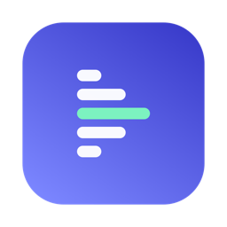
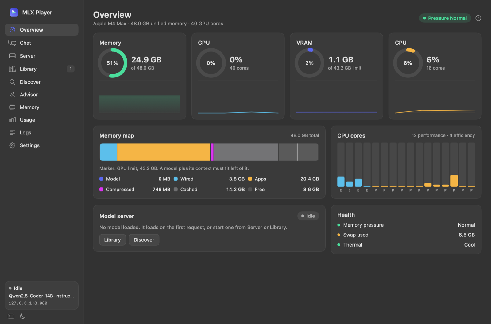
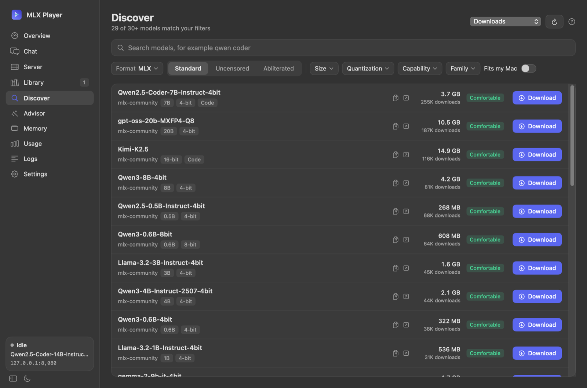
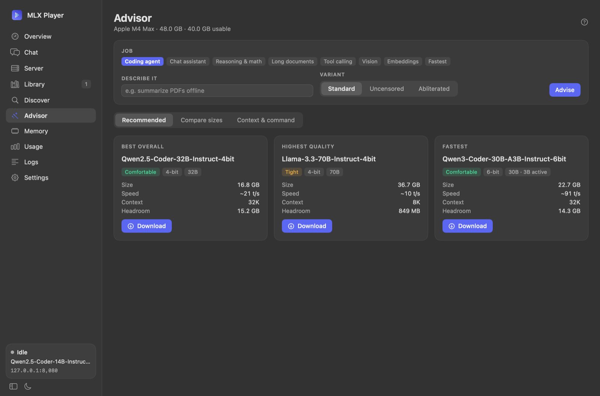
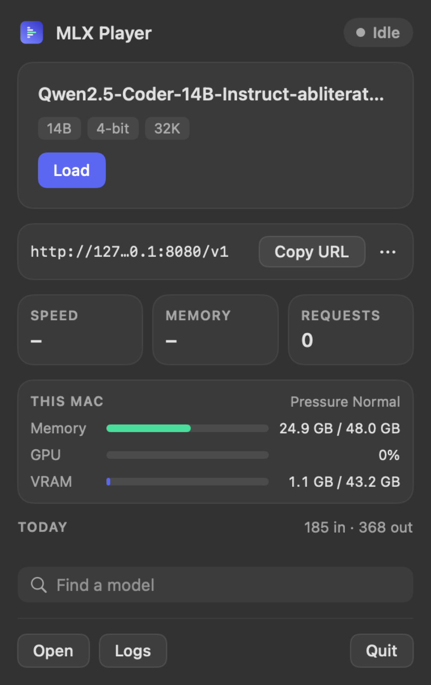
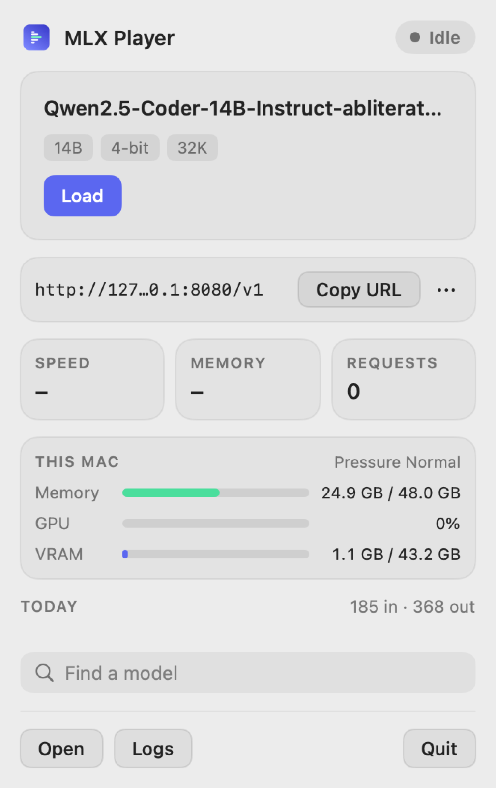

<p align="center">
  
</p>

<h1 align="center">MLX Player</h1>

<p align="center">
  A native macOS menu bar app that installs and runs <code>mlx-lm</code>, finds models that fit your Mac,<br>
  and serves them on a local OpenAI-compatible endpoint.
</p>

<p align="center">
  
</p>

<p align="center">
  
  
</p>

<p align="center">
  
  
</p>

## What it does

- **One-click setup.** Installs `uv`, a private Python 3.12 and `mlx-lm` under `~/Library/Application Support/MLX Player/`. No admin rights, nothing global.
- **Discover and download** MLX models from Hugging Face, with filters (size, quantization, capability, family, Standard / Uncensored / Abliterated) and a fit badge for your Mac.
- **Advisor.** Tells you what will actually run: fit (comfortable, tight, won't fit), a safe context size, estimated and measured tokens/s.
- **Local server** at `http://127.0.0.1:8080/v1`. A lazy proxy loads the model on the first request, unloads it when idle, enforces the context limit, streams SSE and meters usage.
- **Memory aware.** Live memory, GPU, VRAM and CPU view, GPU wired limit control, automatic responses to memory pressure.
- **Library, Usage, Logs, Chat** screens, plus a Hugging Face token kept in the Keychain.
- **Agent access** through an MCP server, so tools like Claude Code can manage models for you (see below).

## Requirements

- Apple Silicon Mac, macOS 14 or newer
- Xcode command line tools (`xcode-select --install`) to build from source
- Git

## Install

```sh
git clone https://github.com/kalahroudi/mlxplayer.git
cd mlxplayer
scripts/bundle.sh            # builds dist/MLX Player.app
open "dist/MLX Player.app"
```

Optional: copy it to `/Applications`. The build is ad-hoc signed, so on first launch right-click the app and choose Open once.
The app can update itself from this repo (Settings > Updates).

To build a disk image: `scripts/make-dmg.sh VERSION`. Tagging `vX.Y.Z` runs `.github/workflows/release.yml`, which builds, tests and publishes the DMG.

## Use the endpoint

```sh
curl http://127.0.0.1:8080/v1/chat/completions \
  -H "Content-Type: application/json" \
  -d '{"model":"default","messages":[{"role":"user","content":"Hello"}]}'
```

Point any OpenAI-compatible client at `http://127.0.0.1:8080/v1` (any API key value works). The model loads on the first request.

## For AI agents

Agents can install MLX Player and then drive it over MCP. If you are a user, paste the prompt below into your agent (Claude Code, Cursor, Codex, etc.). If you are an agent, follow it.

### Prompt to install

````text
Install MLX Player (https://github.com/kalahroudi/mlxplayer) on this Mac and connect it to me.

1. Check prerequisites: `uname -m` must print `arm64` and `sw_vers -productVersion` must be 14 or newer.
   If `xcode-select -p` fails, tell me to run `xcode-select --install` and wait. Do not continue without it.
2. Clone and build:
   git clone https://github.com/kalahroudi/mlxplayer.git ~/mlxplayer
   cd ~/mlxplayer && scripts/bundle.sh
3. Install the app: `cp -R "dist/MLX Player.app" /Applications/` (if that is not writable, leave it in dist/).
   Launch it with `open "/Applications/MLX Player.app"` and tell me to right-click > Open if macOS blocks it.
4. First run: the app's Setup screen installs uv, Python and mlx-lm. Ask me to click through it,
   or tell me it is already done if Settings shows mlx-lm installed.
5. Register the MCP server for yourself:
   claude mcp add -s user mlxplayer -- "/Applications/MLX Player.app/Contents/MacOS/mlxplayer-mcp"
   (For other agents, add a stdio MCP server named `mlxplayer` with that command.)
   Then restart or reload so the tools appear.
6. Verify by calling `get_hardware` and `get_status`. Report the chip, memory and server state.
7. Do not download or load a model, or change settings, until I approve. Use `recommend_models` and show me the options first.
````

### MCP tools

The MCP server is `mlxplayer-mcp` (stdio), bundled at `MLX Player.app/Contents/MacOS/mlxplayer-mcp`. The app must be running for the control tools.

| Tool | What it does | Asks you first |
|---|---|---|
| `get_hardware` | Chip, memory, GPU memory limit, bandwidth, usable memory for a model | No |
| `search_models` | Search MLX models on Hugging Face | No |
| `analyze_model` | Fit, context size, speed estimate and memory breakdown for a model | No |
| `recommend_models` | Best overall, highest quality and fastest model for a job | No |
| `get_status` | Server state, loaded model, endpoint, memory and speed | No |
| `download_model` | Download a model into the Hugging Face cache | Yes |
| `start_server` | Load a model and start the server (optional `context_length`, `thinking`) | Yes |
| `update_settings` | Change saved settings for a model | Yes |
| `stop_server` | Stop the server and free memory | Yes |
| `delete_model` | Delete a downloaded model | Always |

The app can also register the MCP server for Claude Code itself: Settings > Agents (MCP) > Install. Control calls go through a loopback API protected by a bearer token (`control.json`, mode 0600), and actions that change state show an approval dialog.

## Development

```sh
swift build        # core, MCP server and the macOS app
swift test         # 94 tests (the proxy streaming tests need python3)
swift run mlxplayer-mcp
MLXPlayer --snapshot DIR [dark] [collapsed] [screen]   # render screens to PNG (used for the images above)
```

Layout:

| Path | Contents |
|---|---|
| `Sources/MLXPlayerCore` | UI-free logic: hardware, advisor, installer, server supervisor, lazy proxy, usage, memory policy, Hugging Face client, MCP |
| `Sources/MLXPlayer` | The macOS app (SwiftUI + AppKit) |
| `Sources/mlxplayer-mcp` | Stdio MCP server |
| `scripts/` | Bundle, DMG and notarization scripts |
| `design/` | Approved mockups (open the `*.dc.html` files in a browser) |

Notes: the sandbox must stay off because the app spawns processes. `mlx_lm.server` has no `--max-kv-size` in 0.32.2, so the proxy enforces context limits by estimating tokens.

## Roadmap

Built but not yet verified on real hardware or in release:

- Developer ID signing and notarization (the workflow is written, no certificate has run it)
- Updating from a real published release (only the branch/source path was run end to end)
- Installing the GPU limit launch daemon ("Keep after restart")
- Memory pressure responses under real pressure

Not built:

- Playground screen
- Quality ranking from a refreshable benchmark table (today it is a size/quantization heuristic)
- AI-based Advisor free text (today it is keyword matching)
- Persistent chat history (in memory only)
- Live "trim prompt cache" (mlx-lm has no API; the app restarts with a smaller cache when idle)

## License

No license file yet. Add one before accepting contributions.
